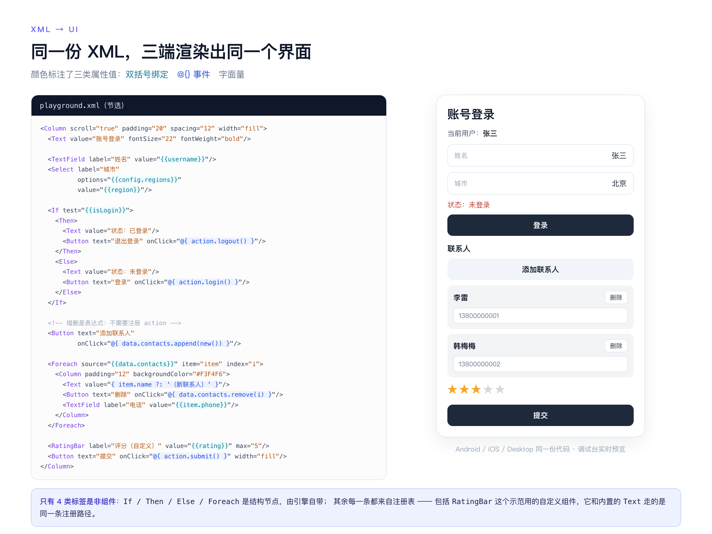
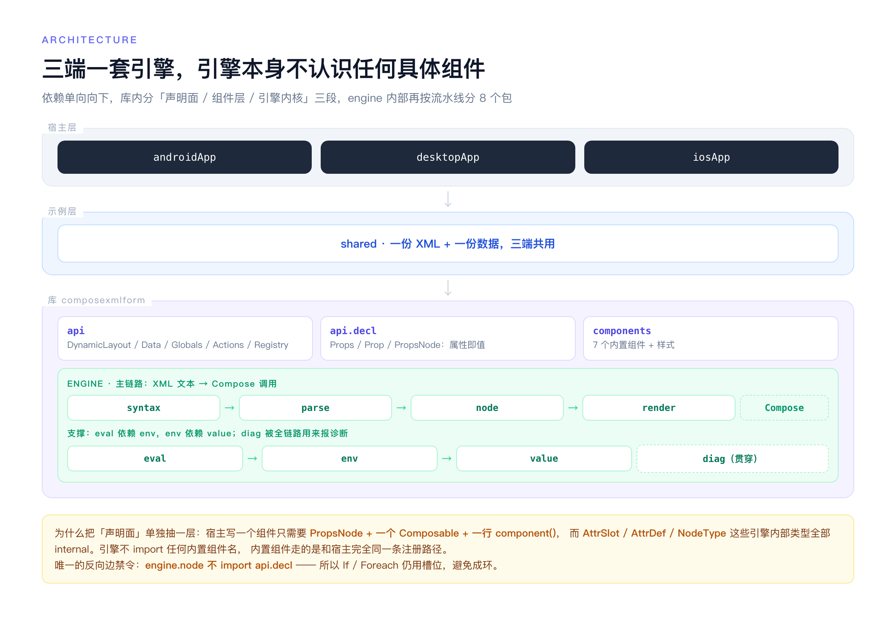
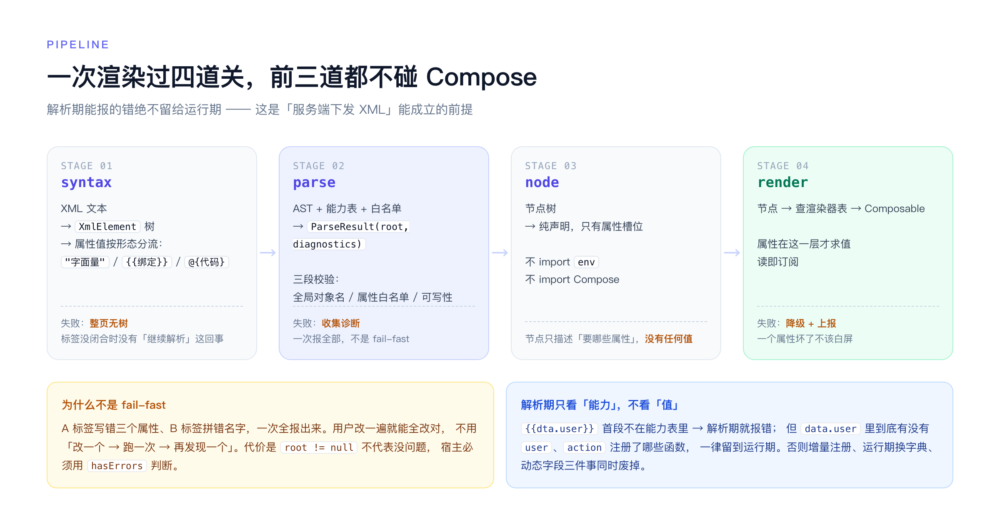

# ComposeXmlForm

> 用 XML 描述界面，由 Compose 渲染。一份 XML + 一份数据，Android / iOS / Desktop 跑出同一个**原生**页面。
> 不是 WebView，也不是自绘 —— 每个标签最终都编译成一次 Compose 组件调用。



```kotlin
val data = rememberData(mapOf("username" to "张三"))
DynamicLayout(xml = FORM_XML, data = data)
```

## 特性

- **XML 即界面**：7 个内置组件（`Text` / `Button` / `TextField` / `Select` / `Column` / `Row` / `Box`）+ 4 个结构标签（`If` / `Then` / `Else` / `Foreach`）。
- **三种属性值**：`"字面量"`、`{{path}}`（双向绑定，读即订阅）、`@{ 脚本 }`（事件）。
- **解析期全量诊断**：标签拼错、属性不在白名单、把字面量写进可写槽位、`{{dta.x}}` 全局名拼错 —— 一次全报，不是 fail-fast。
- **引擎不认识任何组件**：内置组件与宿主自定义组件走同一条 `registry.component(...)` 路径。
- **组件只需三块代码**：`PropsNode` + 一个 Composable + 一行注册；属性名只写一遍。
- **细粒度重组**：`DataObject` 每个 key 一个 `MutableState`，`Foreach` 按元素身份复用行。

## 模块划分

| 模块 | 角色 | 说明 |
| --- | --- | --- |
| [`composexmlform`](./composexmlform) | **库** | 引擎本体，包名 `cn.changjiahong.composexmlform`，门面对象 `ComposeXmlForm`，可被任意 Compose 工程依赖 |
| [`shared`](./shared) | 示例 | 跨平台示例 UI（`App.kt` 最小示例、`Playground.kt` 三栏调试台），包名 `cn.changjiahong.sample` |
| [`androidApp`](./androidApp) | 示例 | Android 宿主（applicationId `cn.changjiahong.sample`） |
| [`desktopApp`](./desktopApp) | 示例 | 桌面宿主 + 调试台（左 XML 编辑、右实时渲染、底部数据快照与诊断） |
| [`iosApp`](./iosApp) | 示例 | iOS 宿主（Xcode 工程，`import Shared`） |

依赖方向单向：`androidApp / iosApp / desktopApp → shared → composexmlform`。库内不含任何示例代码。

## 快速开始

```kotlin
// settings.gradle.kts
include(":composexmlform")

// 依赖方
dependencies {
    implementation(project(":composexmlform"))
}
```

```kotlin
@Composable
fun ProfileForm() {
    // 业务数据：可写根
    val data = rememberData(
        mapOf(
            "username" to "张三",
            "region" to "BJ",
            "isLogin" to false,
            "contacts" to listOf(
                mapOf("id" to 1, "name" to "李雷", "phone" to "13800000001"),
            ),
        ),
    )

    // 服务端下发的只读资源：整棵子树冻结，写入会抛 FrozenWriteException
    val config = mapOf(
        "regions" to listOf(
            mapOf("label" to "北京", "value" to "BJ"),
            mapOf("label" to "上海", "value" to "SH"),
        ),
    )

    DynamicLayout(xml = FORM_XML, data = data, config = config)
}
```

```xml
<Column scroll="true" padding="20" spacing="12" width="fill">
    <Text value="用户信息" fontSize="22" fontWeight="bold"/>

    <TextField label="姓名" value="{{username}}"/>
    <Select label="城市" options="{{config.regions}}" value="{{region}}"/>

    <If test="{{isLogin}}">
        <Then>
            <Text value="已登录" color="#1B7F3B"/>
            <Button text="退出登录" onClick="@{ action.logout() }"/>
        </Then>
        <Else>
            <Text value="未登录" color="#C0392B"/>
            <Button text="登录" onClick="@{ action.login() }"/>
        </Else>
    </If>

    <!-- 增删是表达式，不需要注册 action -->
    <Button text="添加联系人" onClick="@{ data.contacts.append(new()) }"/>

    <Foreach source="{{data.contacts}}" item="item" index="i">
        <Row spacing="8" verticalAlignment="center">
            <Text value="{ item.name ?: '（未命名）' }"/>
            <Button text="删除" onClick="@{ data.contacts.remove(i) }"/>
        </Row>
    </Foreach>
</Column>
```

动作由宿主注册，名字非法或重复会在**构建期**报错：

```kotlin
val actions = remember {
    actions {
        on("login") { data.set("isLogin", true) }
        on("logout") { data.set("isLogin", false) }
        // 实参随调用进来：@{ action.removeAt(i) }
        on("removeAt") { data.list("contacts").removeAt(intArg(0)) }
    }
}

DynamicLayout(xml = FORM_XML, data = data, config = config, actions = actions)
```

## 自定义组件

一个「点星星打分」的组件，**全部代码三块**：

```kotlin
// ① 声明即读取：名字 / 类型 / 默认值 / 可写性，一行
class RatingBarNode(props: Props) : PropsNode(props) {
    var value by props.varLong("value", 0L)   // var* 可写，其余只读
    val max   by props.long("max", 5L)
    val color by props.string("color")
    val style = props.style()                  // 六个样式属性一次拿全
}

// ② 普通 Composable：node.value 就是 Long，不是槽位
@Composable
fun RatingBar(node: RatingBarNode) {
    Row(node.style.modifier()) {
        repeat(node.max.toInt()) { i ->
            Text(
                text = "★",
                color = node.color.toColor(),
                modifier = Modifier.clickable { node.value = (i + 1).toLong() },
            )
        }
    }
}

// ③ 一行注册：属性表由「构造一次」自动收集
val registry = ComposeXmlForm.createRegistry {
    component("RatingBar", create = ::RatingBarNode, render = ::RatingBar)
}
```

覆盖内置标签用 `replace = true`：

```kotlin
val themed = ComposeXmlForm.createRegistry {
    component("Text", replace = true, create = ::FancyTextNode, render = ::FancyText)
}
```

## 架构



依赖严格单向，库内分三段：`api` / `api.decl` / `components` 是宿主可见面，`engine` 是内核（`syntax` → `parse` → `node` → `render`，由 `value` / `env` / `eval` / `diag` 支撑）。

唯一不可破的反向边：`engine.node` 不 import `api.decl` —— 所以 `If` / `Foreach` 至今仍用裸 `AttrSlot`，避免成环。



## 文档

| 文档 | 内容 |
| --- | --- |
| `DESIGN.md` | 分层、语义契约、每条规则的"为什么" |
| `IMPLEMENTATION.md` | 逐文件职责、实现细节、已知缺口 |
| `API_USAGE.md` | 可复制的用法与访问器速查 |
| `DECISIONS.md` | 实现期裁决 I-1~I-79（含已废除项） |

> 上述四份文档目前维护在仓库外的 `WorkBuddy/ComposeXmlForm`（含 `REFACTOR_V2/` 过程文档），
> 时机合适会迁入 `docs/`。`docs/images/` 里是本 README 用到的配图。

## 运行示例

- Android：`./gradlew :androidApp:assembleDebug`
- Desktop：
  - 热重载：`./gradlew :desktopApp:hotRun --auto`
  - 普通运行：`./gradlew :desktopApp:run`
- iOS：
  - 用 Xcode 打开 `iosApp/` 运行（可选择模拟器或真机）
  - 在 Android Studio 里一键跑到真机：选运行配置 **iosApp 真机**（配置见 `.idea/runConfigurations/iosApp_iPhone.xml`，实际执行 `scripts/run-ios-device.sh`），等价于命令行：
    ```bash
    ./scripts/run-ios-device.sh              # 构建 + 安装 + 启动到第一台已连接 iPhone
    CONSOLE=1 ./scripts/run-ios-device.sh    # 同时把设备控制台输出接到终端
    DEVICE_UDID=<udid> ./scripts/run-ios-device.sh   # 多台设备时指定
    ```
  - 注意：Android Studio 自带的 iOS 真机运行需要 KMP 插件（`+` → **Kotlin Mobile** → 名称 `iOS App`）；若设备下拉框为空，优先用上面的脚本配置。

## 环境要求（iOS 侧）

Android Studio 的 iOS 真机/模拟器能力（设备枚举、断点、控制台）不是自己实现的，而是通过 KMP 插件里的 `JBDeviceService` 直接调用**本机 Xcode 的 CoreDevice / DVT 框架**。所以 Xcode 版本必须与插件、与设备 iOS 版本对得上：

| 项目技术栈 | 官方对应 Xcode | 宿主要求 |
| --- | --- | --- |
| Kotlin 2.4.x（本工程） | Xcode 26.x / 27.x | macOS 15.6+（Xcode 26.3）/ 26.4+（Xcode 27） |
| Kotlin 2.3.x | Xcode 26.0 | macOS 15.6+ |
| Kotlin 2.2.20 | Xcode 16.4 | macOS 14.5+ |
| Kotlin 2.1.20 | Xcode 16.0 | macOS 14.5+ |

排查口径：

- `otool -L "$HOME/Library/Application Support/Google/AndroidStudio<版本>/plugins/kmm-plugin/bin/JBDevice.framework/Versions/A/Resources/JBDeviceService"` 里记录的 `CoreDevice` 版本，就是插件编译时用的 Xcode 版本；若明显高于本机 `/Library/Developer/PrivateFrameworks/CoreDevice.framework` 的版本，IDE 侧设备枚举就会崩（`JBDeviceService` 段错误 → 运行配置里看不到真机）。
- 设备 iOS 版本高于 Xcode 支持的 SDK 时，Xcode 图形界面无法运行/调试该设备，但 `xcrun devicectl install/launch`（脚本用的就是它）仍然可以安装启动，因为它不依赖 Xcode 的 DeviceSupport。

## 测试

```bash
./gradlew :composexmlform:jvmTest     # 引擎用例（293 例）
```

绝大多数用例是纯逻辑（解析、求值、数据层），不依赖 UI；`ApiTest` / `DeclComponentTest` 里有约 30 例用 Compose UI 测试跑端到端。

## 技术栈

Kotlin 2.4 / Compose Multiplatform 1.12 / Gradle 9.5 / AGP 9.1
